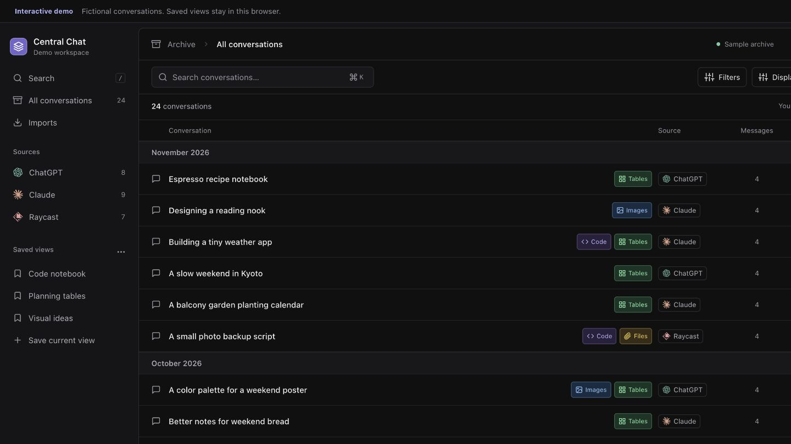
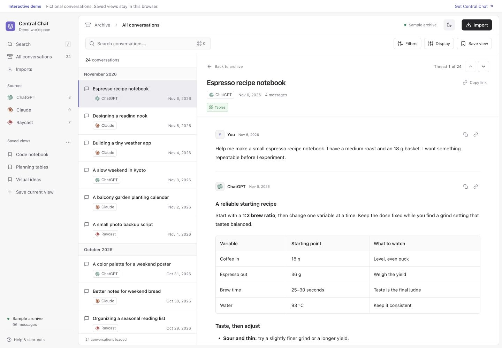
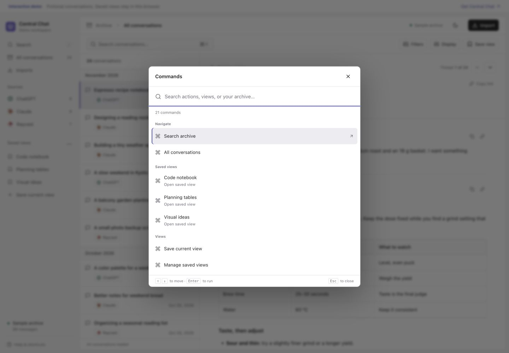
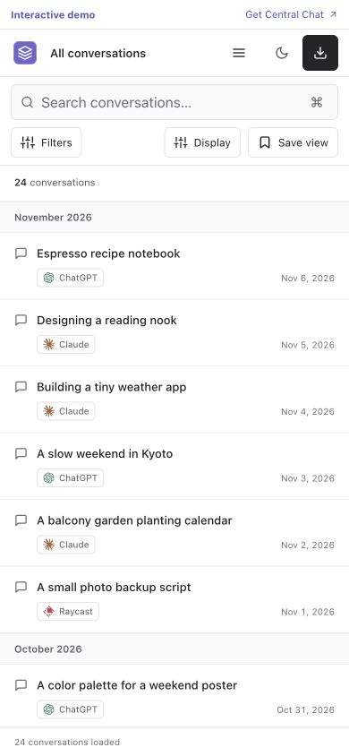

# Central Chat

<picture>
  <source media="(prefers-color-scheme: dark)" srcset="frontend/public/brand/v1/mark-dark.svg">
  
</picture>

[](LICENSE)
[](https://centralchat.fyi)

**A good answer is worth finding again.**

Your useful AI answers are scattered across apps and buried in old threads.
Central Chat brings your exported ChatGPT, Claude, and Raycast conversations into
one searchable archive on your own computer or server.

Remember a Python snippet you discussed months ago, but not which app you used?
Search once across your imported history, narrow the results to conversations
with **Code**, and jump straight to the matching message. Save that search as a
view when you want to return to it.

[Try the interactive demo](https://centralchat.fyi) · [Get started](docs/getting-started.md) · [MIT license](LICENSE)



## From scattered chats to a searchable archive

1. **Export** your history from ChatGPT, Claude, or Raycast using the
   [step-by-step export guide](docs/exporting-your-chats.md).
2. **Import** a complete ZIP/JSON, or extract each export into its own folder and
   use **Detect & Import**. Keep numbered ChatGPT JSON parts together.
3. **Search** across titles and messages, filter by source or content type, and
   save useful views.

To keep the archive current, download a fresh export and import it again.
ChatGPT and Claude messages with stable source IDs merge into existing conversations.
Raycast exports match existing message histories and append new replies; uncertain
matches are flagged for review. See [how repeat imports work](docs/exporting-your-chats.md#raycast-repeat-imports).
Folder detection runs when you rescan; it does not watch for new files automatically.

### Where do I get my files?

| Source | Start here | File to bring back |
| --- | --- | --- |
| ChatGPT | [Settings → Data controls → Export data](docs/exporting-your-chats.md#chatgpt) | The downloaded ZIP; keep all numbered JSON parts together |
| Claude | [Settings → Privacy → Export data](docs/exporting-your-chats.md#claude) | The downloaded ZIP containing `conversations.json` |
| Raycast | [Run the macOS chat exporter](docs/exporting-your-chats.md#raycast-macos) | `raycast_ai_chats.json`, not a `.rayconfig` backup |

The [full guide](docs/exporting-your-chats.md) covers download links, account
restrictions, Raycast setup, server-folder locations, and common import problems.

## Find more than a title

- **Search titles and messages** with SQLite FTS5. Results show matching text and
  open the conversation at the relevant message.
- **Filter by content.** Click the colored Code, Images, Tables, Files, Audio, or
  Video badges, or choose a content type in Filters. Combine it with a source,
  message role, date, or search query.
- **Save a view.** Keep a search, filters, sorting, and display settings together.
  Saved views live in your database and are available from every device connected
  to your instance. Update, rename, or remove a view without changing the archive.
- **Make the list your own.** Display offers compact or comfortable rows, date or
  source grouping, sorting, and controls for visible metadata and search previews.
- **Move through conversations.** Previous/next controls follow the current view
  across pages. Use `J` and `K` while reading, or open the command palette with
  `⌘K` / `Ctrl+K`.
- **Read comfortably.** Light and dark themes, responsive layouts, formatted
  Markdown tables, syntax-highlighted code, and copy controls for messages and
  links.
- **Import complete exports.** Detect extracted folders or upload a ZIP/JSON.
  Numbered ChatGPT JSON parts stay together; stable source IDs let re-imports
  merge messages. Raycast uses conservative transcript matching for fresh exports.

## Quick start

The [public demo](https://centralchat.fyi) uses fictional conversations. Explore
its interface without installing anything. Demo saved views stay in that browser;
your own instance stores
views on the server. Every screenshot below uses synthetic demo data.

To run your own instance, you need Docker Compose, Node.js 22 or later, and
**pnpm 11.19.0**. The commands use the `sfw` package-security launcher described
in the [setup guide](docs/getting-started.md).

```sh
git clone https://github.com/daveonkels/centralchat.git
cd centralchat
mkdir -p data imports
cd frontend
sfw pnpm install --frozen-lockfile
sfw pnpm run build
cd ..
docker compose up -d --build
```

Open [localhost:3000](http://localhost:3000), choose **Import**, and add your exports.
See the [setup guide](docs/getting-started.md) for local development, import
instructions, and remote hosting.

## Privacy and current boundaries

Central Chat stores conversations and saved views in SQLite. It does not require
AI API keys or send your archive to an AI service. A self-hosted instance sends
data between your browser and your server.

- **An archive of exports.** It does not connect to your AI accounts, sync live
  conversations, or let you send new messages to AI models.
- **Keyword and phrase search.** Search uses SQLite FTS5; semantic search and
  asking an AI questions about your archive are not included.
- **Attachment references.** Images, Files, Audio, and Video badges identify
  references in exported messages. Original attachment contents are not hosted,
  transcribed, or indexed. Referenced images appear as links; opening an external
  link contacts that destination.
- **Three supported sources today:** ChatGPT, Claude, and Raycast. Other services
  require their own importers; arbitrary JSON files are not interchangeable.
- **A personal instance.** There are no built-in user accounts, sign-in controls,
  or permissions for separate users. Keep remote deployments on a private network
  or behind an authenticated reverse proxy.

## Help bring Grok and Gemini to Central Chat

**Use Grok or Gemini? Help us validate their exports.** Neither provider is
supported yet. We found useful community examples, but not enough evidence to
validate conversation reconstruction and duplicate-safe updates. Both importers
are on hold pending samples; see the [research and contribution guide](docs/importer-backlog.md).

The most useful contribution is a small export of **deliberately fictional test
chats**, downloaded through the provider's own export tool. Include multiple
conversations, a few follow-up messages, and a second export after adding a reply.
Code, tables, and harmless attachments help test richer content too.

[Open an export-sample issue](https://github.com/daveonkels/centralchat/issues/new?title=Export%20sample%20offer%3A%20Grok%20or%20Gemini)
with the provider, export date, format, and cases you can cover. **Do not attach
your full personal archive.** Read the [sample checklist](docs/importer-backlog.md#contributing-a-sample)
before sharing files; public issues and pull requests are visible to everyone.
You can also help by testing a future importer locally without sharing your history.

### Importer backlog

- [ ] **Grok:** validate native account exports, message order, and repeat imports;
  document branch and attachment limitations before an experimental release.
- [ ] **Gemini:** validate Google Takeout **My Activity → Gemini Apps** exports,
  conversation grouping, missing replies, and repeat exports before releasing an
  experimental importer. Google AI Studio exports are a separate format.
- [ ] **Release checks:** test folder detection and ZIP/JSON uploads, verify search
  and source filters, and label experimental support and known omissions in the UI.

## Search and shortcuts

Search normally, or combine words with operators:

```text
espresso platform:claude
"design tokens" role:assistant
garden before:2026-06-01
```

The self-hosted search supports FTS expressions such as `coffee OR tea` and prefix
searches such as `garden*`. Source values are `openai`, `claude`, and `raycast`.
One content type can be selected at a time, alongside the other filters.

| Shortcut | Action |
| --- | --- |
| `⌘K` / `Ctrl+K` | Open commands, saved views, filters, and actions |
| `/` | Focus archive search |
| `↑` / `↓`, then `Enter` | Navigate focused results and open a conversation |
| `J` / `K` | Next / previous conversation while reading |
| `?` | Open help when not typing in a control |
| `Escape` | Close a dialog or clear the focused search field |

## A closer look

### Conversation reader



### Commands



### On your phone



## Built with

| Layer | Technology |
| --- | --- |
| Frontend | React, TypeScript, Vite |
| Backend | Python, FastAPI |
| Storage and search | SQLite with FTS5 |
| Hosting | Your computer or server; Docker and nginx support |

The interface adapts patterns from [Circle](https://github.com/ln-dev7/circle).
Its MIT notice is retained in [the frontend licenses](frontend/public/licenses/circle.txt).

## Development

See [Getting started](docs/getting-started.md) for Docker, local development,
imports, and data storage. JavaScript tooling uses **pnpm 11.19.0**, as declared
in [frontend/package.json](frontend/package.json). Use the locked dependencies;
do not substitute another package manager.

Central Chat is released under the [MIT license](LICENSE).
